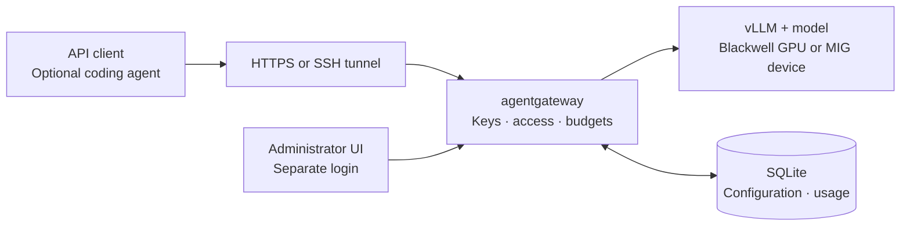

# Blackwell Model Serving Blueprint

**Deploy a model on a Blackwell server, give each user an API key, and track usage through a gateway.**

The default installation serves **Qwen3.8-27B NVFP4 on one B200 MIG `4g.90gb` allocation**, with a separate CPU gateway host. An **RTX PRO 6000 Blackwell** server is the standalone demo option. Clients receive an OpenAI-compatible API; OpenCode is an optional coding-agent client.

**New here? Follow the installation steps below.** You can run them manually or use an already-working AI coding agent to help. Both paths use the same configuration and guides.

[Install step by step](#install-step-by-step) · [Install with an AI agent](#install-with-an-ai-agent) · [Everyday commands](#everyday-commands) · [All documentation](docs/README.md)

## What runs where

| Component | What it does | Where it runs by default |
|---|---|---|
| vLLM + Qwen | Loads the model and generates answers or tool calls | Slurm-allocated B200 MIG device |
| agentgateway | Checks user keys, applies budgets and routes API requests | Stable Linux CPU host |
| SQLite | Stores gateway configuration and usage records | Persistent local disk on the gateway host |
| API client / optional coding agent | Sends requests; executes its own approved tools | User's laptop or development machine |



For the standalone demo, the gateway and model share one Linux host. A gateway status of “ready” does not prove the model is ready. See [Architecture](docs/reference/architecture.md) for responsibilities and network boundaries.

## Install step by step

### 1. Choose your installation path

| Your hardware | Installation guide | Who prepares it |
|---|---|---|
| **Default: B200 MIG `4g.90gb` (SM100)** | [B200 with Slurm](docs/deploy/b200-slurm.md) | Cluster administrator provides the allocation, networking and service accounts |
| RTX PRO 6000 Blackwell (SM120), demo | [Standalone installation](docs/start/install.md) | Linux administrator prepares the GPU host |
| Full B200 (SM100), standalone alternative | [Standalone installation](docs/start/install.md) | Linux administrator prepares the GPU host |
| You only need access to an existing service | [Agent/client settings](docs/deploy/agent-settings.md) | Operator gives you the `/v1` URL, user key and model name |

**RTX PRO 6000 Blackwell is different from RTX 6000 Ada and RTX A6000.** The launcher detects the visible GPU family automatically. It does not create MIG partitions or choose another user's device. See [GPU compatibility](docs/deploy/gpu-compatibility.md).

### 2. Get the host details and project files

Before starting, obtain:

- A Linux server address and a non-root service account with SSH or console access.
- The repository URL or release ZIP from your maintainer.
- An assigned GPU/MIG device, writable model storage and access to the pinned image/model downloads.
- Administrator approval for package installation and Docker access on the gateway/demo host.
- For B200: the Slurm account, partition, MIG GRES name, shared paths, reserved backend port and private route to the gateway. Record these in the [site handover table](docs/deploy/b200-slurm.md#0-prepare-the-handover-and-identify-each-host).

Use **Bash** for the examples. Replace hostnames and example paths before running commands. The serving stack runs on Linux; your Mac or Windows laptop can connect to it or run an API client.

**On your laptop**, connect to the gateway or standalone demo host:

```bash
ssh operator@server.example
```

**On that Linux host**, open Bash and download the project using the URL your maintainer supplied:

```bash
bash
mkdir -p "$HOME/services"
cd "$HOME/services"
read -r -p 'Repository URL: ' REPOSITORY_URL
git clone "$REPOSITORY_URL" blackwell-model-serving
cd blackwell-model-serving
```

If Git is missing on a new Ubuntu host, an authorized administrator can install it first with `sudo apt-get update` followed by `sudo apt-get install -y git ca-certificates`. Alternatively, extract the supplied release ZIP and enter the directory containing `README.md`, `gateway` and `compose.yaml`.

Verify the package, then make the launcher executable if your ZIP extractor lost its permissions:

```bash
sha256sum -c MANIFEST.sha256
chmod +x gateway
```

**Expected:** checksum entries report `OK`. Stop on mismatches and obtain an intact package. All subsequent `./gateway` commands run from this repository directory on the gateway/demo host. The B200 runbook separately explains how to stage a copy on cluster-visible storage.

### 3. Check and install prerequisites

The automatic package installer supports **Ubuntu 24.04 LTS x86-64 with systemd**. It uses sudo for package changes. Other distributions need administrator-managed preparation.

| Location | Required packages/components |
|---|---|
| Gateway or demo host | `bash`, `coreutils`, `grep`, `sed`, Python 3.10+ with SQLite/TLS support, `curl`, `ca-certificates`, `gnupg`, `openssl`, `apache2-utils`, `git`, `unzip`, `nano`, `openssh-client` |
| Gateway or demo host | Docker Engine and Compose: `docker-ce`, `docker-ce-cli`, `containerd.io`, `docker-buildx-plugin`, `docker-compose-plugin` |
| Automatic installer | Ubuntu APT/dpkg and systemd; administrator-approved sudo or root access for package installation |
| Standalone GPU demo | Compatible NVIDIA driver, NVIDIA Container Toolkit and configured Docker GPU runtime |
| B200 cluster | Site-managed NVIDIA driver, MIG, Slurm/GRES/cgroups, Enroot/Pyxis; `hf` CLI on the staging host |
| Published service | Site-managed HTTPS ingress, certificates and backend isolation |
| Optional coding-agent client | An installed agent and the runtimes/tools required by the user's coding project |

PyTorch, CUDA libraries and vLLM are in the pinned inference container. Agentgateway is in its own container. The gateway helpers need no extra Python packages or separate database server. See the [full prerequisite checklist](docs/start/prerequisites.md), including SSH access and administrator-owned components.

**For the default B200 deployment, run on the CPU gateway host:**

```bash
./gateway prerequisites
```

If it reports missing packages, install them on the supported Ubuntu host, then repeat the check:

```bash
./gateway prerequisites --install
./gateway prerequisites
```

**For the standalone GPU demo, use the demo role instead:**

```bash
./gateway prerequisites --role demo
./gateway prerequisites --role demo --install
./gateway prerequisites --role demo
```

**Expected:** required checks report `OK`. Package installation can still leave account access, the driver or GPU runtime needing administrator action. Follow [host setup](docs/start/host-setup.md) for those steps, then repeat the check as the service owner. Package changes can affect running services; use an approved maintenance window on an existing host.

The installer does not install drivers, grant Docker-group access, partition MIG or configure Slurm. **Do not run the Docker installer on cluster compute nodes.** If Python is missing, the shell launcher can still run `prerequisites --install`.

### 4. Configure and launch the model, then the gateway

Open the guide for your selected hardware and follow its commands in order:

**Reuse the project directory you already downloaded.** In the standalone guide's section 1, skip the repeated clone/ZIP steps, complete its remaining account and package checks, then continue to backend configuration in section 2. For B200, keep this gateway-host copy and follow the cluster guide's separate staging instructions for the submission host; do not clone over an existing directory.

| Path | What the guide walks you through | Expected outcome |
|---|---|---|
| [B200 cluster installation](docs/deploy/b200-slurm.md) | Record site settings → stage pinned artifacts and private credentials → submit one MIG allocation → bootstrap the CPU gateway → configure isolation and HTTPS | Gateway reaches the allocated model; ordinary clients use the protected API |
| [Standalone demo installation](docs/start/install.md) | Create private backend configuration → check the GPU → start the model → bootstrap the gateway → issue a user key → make a request | Model health and gateway readiness return HTTP 200; an authenticated request returns an answer |

Bootstrap creates the private `.env`, administrator login and `runtime/` directories. **`./gateway start` starts the gateway after bootstrap; it does not install or start the model.** Keep existing state intact when rerunning setup. For an existing deployment, follow [migration instructions](docs/operate/administration.md#migrate-an-existing-installation).

Three credentials have different jobs: the **backend key** connects the gateway to vLLM, the **administrator login** manages the service, and an individual **user key** calls the model. Give ordinary users their user key, API URL and model name `qwen-coder`.

### 5. Make your first request and connect a client

Use the `developer-a` key created by the standalone guide. If you are following the B200 path and have not created that key, create it on the initialized gateway host:

```bash
./gateway users add developer-a --daily-tokens 1000000
```

The key is saved to `runtime/secrets/developer-a.key`. If that file already exists, use the existing key or follow the rotation instructions rather than overwriting it. Keep initial access with the commissioning team until acceptance is complete.

The [standalone first-request example](docs/start/install.md#6-test-the-api-without-an-ai-agent) uses Python's standard library, reads a private user-key file and prints the answer and usage. It also works on the B200 gateway host once its gateway routes to the model. You do not need an AI agent or paid API account to make this request.

**Expected:** HTTP 200, a generated reply and token usage. For a remote client, the operator supplies an HTTPS base URL ending in `/v1`, or the documented SSH tunnel. The administrator UI has its own protected access; it is not the ordinary user's endpoint.

To use the service for coding, follow [Agent settings and tool calling](docs/deploy/agent-settings.md). The supplied OpenCode configuration enables reasoning and tool calls and preserves reasoning across turns. Tools run on the client machine, subject to its permissions and installed dependencies.

### 6. Qualify the service before sharing it

A short reply establishes basic connectivity. Follow your guide's gateway, tool-calling, network-isolation and [200K-input acceptance steps](docs/deploy/b200-slurm.md#6-qualify-200k-context-separately) before advertising the service's capacity. Keep reports private under `runtime/` and record any checks you could not execute.

The starting configuration is **262,144 total context tokens, a 200,000-token input target, up to 32,768 output tokens, and one active sequence on one GPU/MIG device**. Input includes history and tool content; output includes reasoning. Thinking is enabled with preserved reasoning, `xhigh` effort and the recommended Qwen sampling preset. These are configured limits, not measured B200 capacity. See [Agent settings](docs/deploy/agent-settings.md) for exact values.

## Install with an AI agent

**For beginners, we recommend using an AI coding agent with terminal access to help follow the installation guide.** Open this repository in an already-working agent, or give it an approved SSH connection to the intended host. It can inspect prerequisites, run the documented commands, explain errors and keep track of progress. You still supply the host access and site-specific values.

The model being installed is not available to power that agent until deployment succeeds. You can use your existing agent for setup; OpenCode connected to this new service is an optional step afterward. Manual installation remains fully supported.

Copy this prompt into your agent, fill in the deployment type and available site details, and let it work through the guide:

```text
Help me install this Blackwell Model Serving Blueprint from the current repository.

Deployment: B200 MIG 4g.90gb with Slurm (default).
For a standalone RTX PRO 6000 Blackwell demo, use that path instead.
Available host/account details: [provide hostnames, account names and site paths;
use approved SSH access and private credential files, not pasted passwords or keys].

Read README.md, docs/start/prerequisites.md and the installation guide for my
chosen deployment. Identify which commands belong on the gateway, submission,
compute and client hosts before executing them. Inspect existing installation
state and preserve it. Ask only for missing site values or required authorization;
do not invent a Slurm partition, MIG GRES, hostname, port or filesystem path.

Check prerequisites with ./gateway prerequisites (add --role demo for the
standalone GPU host). Install missing supported-host packages with --install
where I have authorized administrator access. Use the guide's manual steps for
missing drivers, Docker access and GPU runtime configuration. Leave MIG, Slurm,
firewall and shared-host changes to the authorized site administrator. Do not
install Docker on Slurm compute nodes or provision paid infrastructure.

Follow the guide through model launch, gateway bootstrap, individual user-key
creation and an authenticated request. Keep the pinned artifacts and default
262144 context, 32768 output allowance, thinking and tool-calling settings.
Keep secrets in private files; do not print them or commit runtime state.

Run the documented acceptance checks when execution is authorized. If a step
is blocked, report the exact blocker and continue independent work. Finish with
the API URL/model name, private credential-file locations, commands to operate
the service, checks completed, and anything still unverified. Do not claim that
a service or tool call works just because its configuration exists.
```

The agent follows the same [B200](docs/deploy/b200-slurm.md) or [standalone](docs/start/install.md) runbook as a person. Review commands that require administrator privileges and retain its final handover for the operator.

## Everyday commands

Run on the gateway host after installation. `./gateway --help` and `./gateway COMMAND --help` explain options.

| Task | Command |
|---|---|
| Start / inspect | `./gateway start` · `./gateway status` |
| See logs / follow logs | `./gateway logs` · `./gateway logs --follow` |
| Restart / stop | `./gateway restart` · `./gateway stop` |
| Create an individual key | `./gateway users add developer-a --daily-tokens 1000000` |
| List / revoke keys | `./gateway users list` · `./gateway users revoke KEY_ID` |
| View usage | `./gateway usage` · `./gateway usage --days 7` |
| Back up the database | `./gateway backup` |

A new key is saved privately to `runtime/secrets/developer-a.key`; it is not printed, and existing files are not overwritten. Use the ID from the listing to revoke it. Backups here contain the database only; keep configuration and secrets in your encrypted off-host backup process. Token budgets are access controls, not exact GPU billing or fair scheduling.

See the [CLI guide](docs/operate/cli.md) for all options and [Administration](docs/operate/administration.md) for the UI, budgets, migration, restore and troubleshooting. GPU model jobs are managed separately.

## Find your way around

| Folder or file | Purpose |
|---|---|
| [docs/README.md](docs/README.md) | Complete guide index organized by task |
| [gateway](gateway) | Operator command for prerequisites, lifecycle, keys, usage and backups |
| [inference/](inference/backend.env.example) | Model settings and Docker/Slurm launchers |
| [compose.yaml](compose.yaml), [gateway.yaml](gateway.yaml) | Gateway container and request policies |
| [scripts/](scripts/bootstrap.py) | Setup, administration and acceptance helpers |
| [client/](client/opencode.json) | Optional OpenCode configuration |
| [deploy/](deploy/nginx-location.conf) | HTTPS reverse-proxy snippet |
| [tests/](tests/test_helpers.py) | Maintainer tests |
| [evidence/](evidence/prototype-verification.json) | Sanitized historical reports |
| [versions.json](versions.json), [MANIFEST.sha256](MANIFEST.sha256) | Artifact pins and file checksums |

Installation creates a private, Git-ignored `runtime/` directory for secrets and gateway state. Model weights and real credentials are not included. Follow [Use a different model](docs/deploy/change-model.md) to adapt the Qwen example.

## Scope and current status

Before distributing a customized copy or making a repository public, follow [Credentials and public distribution](SECURITY.md). Live keys, environment files, databases and private recovery archives do not belong in the published package.

This is a single-gateway reference implementation, not an NVIDIA-certified blueprint. The recorded RTX prototype is retired. B200 execution, the current thinking-mode configuration, the new CLI and fresh-host package installation still need execution on the target server. Recent changes received static review without test execution. Historical reports do not certify a new deployment. See the [validation record](docs/reference/validation.md).

## License

Copyright 2026 Blackwell Model Serving Blueprint contributors.

The original code, configuration and documentation in this repository are licensed under the [Apache License 2.0](LICENSE). You may use, modify and redistribute them, including commercially, subject to the license terms.

Downloaded model weights, container images and third-party software retain their own licenses and terms; this repository's license does not replace them. Review the selected model's license and the terms accompanying each dependency before use or redistribution. [Primary references](docs/reference/sources.md) and [artifact pins](versions.json) identify the upstream components used by this example.
